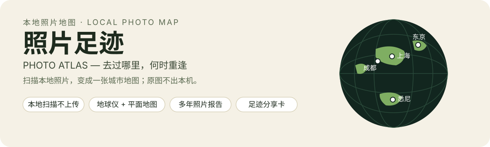
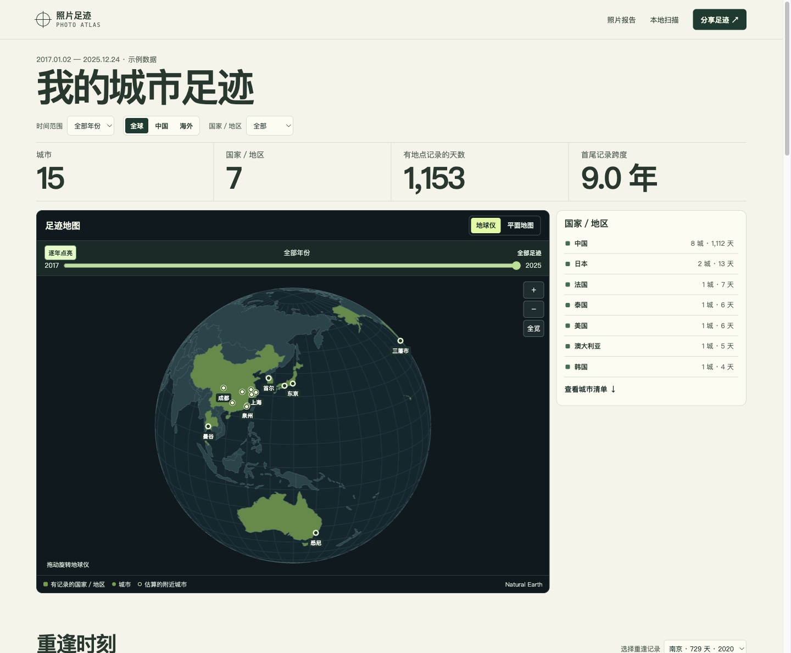
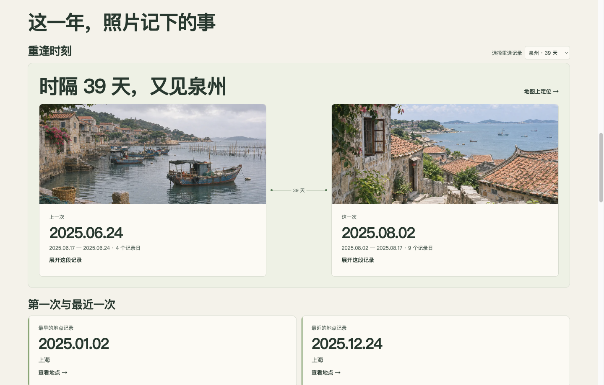
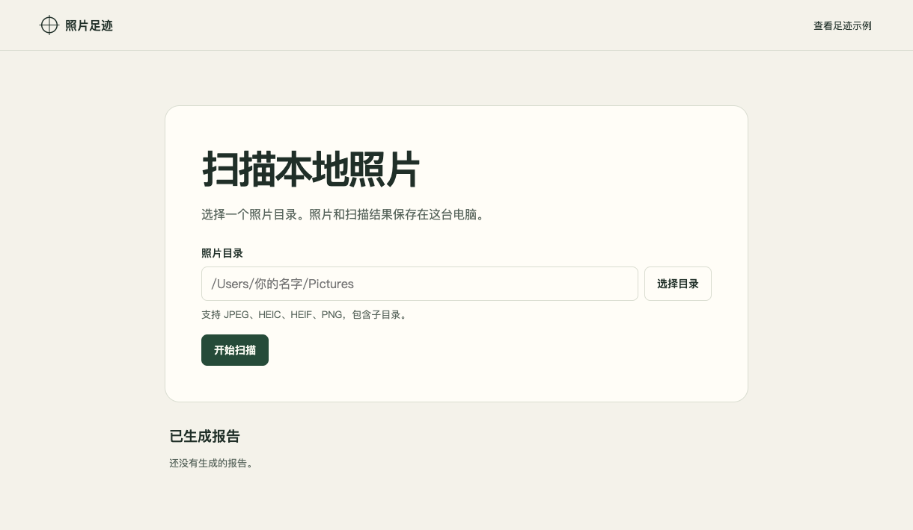

<p align="right"><a href="README.md">中文</a></p>

<p align="center">
  
</p>

<p align="center">
  <a href="https://xiaosang.cc/photo-atlas/">▶ Live Demo</a>
  ·
  <a href="https://xiaosang.cc/photo-atlas/annual.html">Photo Report</a>
  ·
  <a href="https://github.com/holynova/photo-atlas">GitHub Repository</a>
</p>

Photo Atlas turns the photos scattered across your hard drive into a map of where you've been and when you returned: scan a folder locally, read each photo's time and GPS, light up visited cities on a globe, and revisit first visits, reunions, and longest stays across the years. Originals, index, and thumbnails never leave your computer.

## Screenshots

<p align="center">
  
  
</p>

The public demo uses fictional records and generated images.

## Features

- **City footprints**: switch between an interactive globe and a flat map; filter by year or country; replay cities lighting up year by year.
- **Check-ins & lists**: manually add past visits, keep a travel wishlist, and tag cities with personal roles (hometown, workplace, home base).
- **Photo reports**: revisit first visits, reunions, longest stays, and city changes across one year or many; open the map, calendar, or story cards to see the photos behind each moment.
- **Share cards**: pick cities and export a footprint card with no photos attached; report cards can optionally include a cover.
- **Local-first**: annotations, check-ins, and lists live in your browser and survive rescans of the same folder.

## Scan Locally

Requires Node.js 22 or newer:

```sh
git clone https://github.com/holynova/photo-atlas.git
cd photo-atlas
npm ci
npm run local
```

Pick a folder in the browser or paste a path, then click 「开始扫描」 ("Start Scanning"). When it's done, open the photo report or city footprints from 「已生成报告」 ("Generated Reports"). Or run `npm run scan -- "/photo/folder"` directly.

<p align="center">
  
</p>

- **Four formats only**: JPEG, HEIC, HEIF, and PNG; subfolders included; hidden items, symlinks, and Apple Photos library packages are skipped (Apple Photos users should export to a plain folder first).
- **Time & cities**: EXIF original shoot time is preferred; in China, GPS is matched against prefecture-level administrative boundaries; abroad, the nearest city is estimated from city reference points within 15 km. Photos without GPS still count toward shoot-date stats.
- **Visit days**: counted by recorded calendar days; multiple cities on the same day count once in the total.
- **Data location**: each scan saves an index and metadata-stripped thumbnails; on macOS the default is `~/Library/Application Support/Photo Atlas`, customizable with `PHOTO_ATLAS_DATA_DIR`; the service only listens on the local loopback address.

## Tech

- Pure-frontend display (`web/`, vanilla JS + Canvas globe) + a Node.js local scanning service (`local/`).
- Metadata reading uses exiftool-vendored, thumbnails use sharp; Chinese prefecture boundaries and overseas city reference points live in `assets/`.
- Base map and country boundaries come from public-domain data Natural Earth 5.1.2; Chinese prefecture boundaries from chinese-global-compliant-geodata (TianDiTu source, see `assets/china-cities.LICENSE`); overseas city reference points from GeoNames (CC BY 4.0).

```
web/                Public demo: footprint page, photo report, share cards
local/              Local scanning service and scan page (cli.mjs / scan.mjs / server.mjs)
assets/             Geographic data (Chinese cities, world city centers, country boundaries) and annual report artwork
scripts/build.mjs   Build the public demo package
docs/               Local scanning guide, footprint research, and 120 report metrics
```

Metrics and research in `docs/footprint-research.md`; location and statistics details in `docs/local-scanning.md`.
