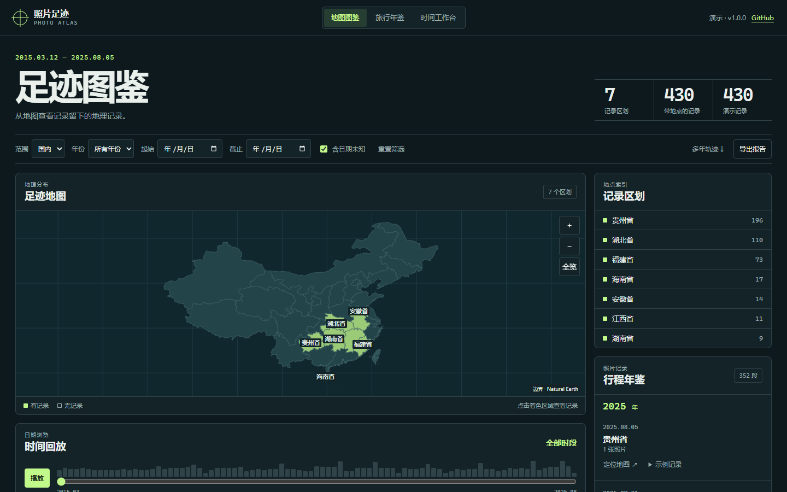

# 照片足迹 / Photo Atlas

用虚构记录体验行政区地图、时间回放、行程年鉴和多年轨迹。公开版无需登录，也不接收照片。

Explore an administrative map, time playback, journey summaries and multi-year patterns with synthetic records. The public demo needs no account and accepts no photo uploads.



- [Cloudflare Demo](https://xiaosang.cc/photo-atlas/)
- [GitHub Repo](https://github.com/holynova/photo-atlas)


```sh
npm ci
npm run dev
npm run deploy:check
```

发布到作品集路径时，先设置 `PHOTO_ATLAS_PORTFOLIO_DIR` 为作品集仓库目录，再运行 `npm run publish:portfolio`；随后在作品集仓库运行 `npx wrangler deploy --config wrangler.jsonc`。

底图由 [Natural Earth 5.1.2](https://github.com/nvkelso/natural-earth-vector/tree/v5.1.2) 公共领域数据简化生成。
