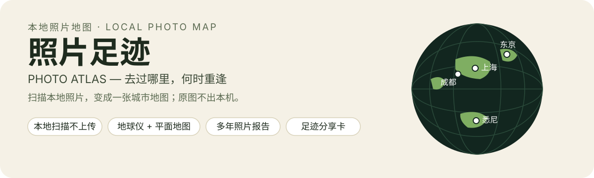
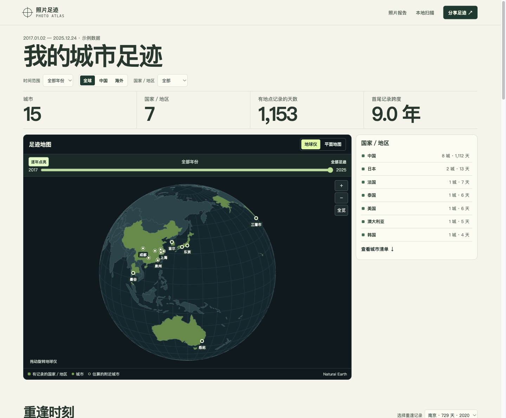
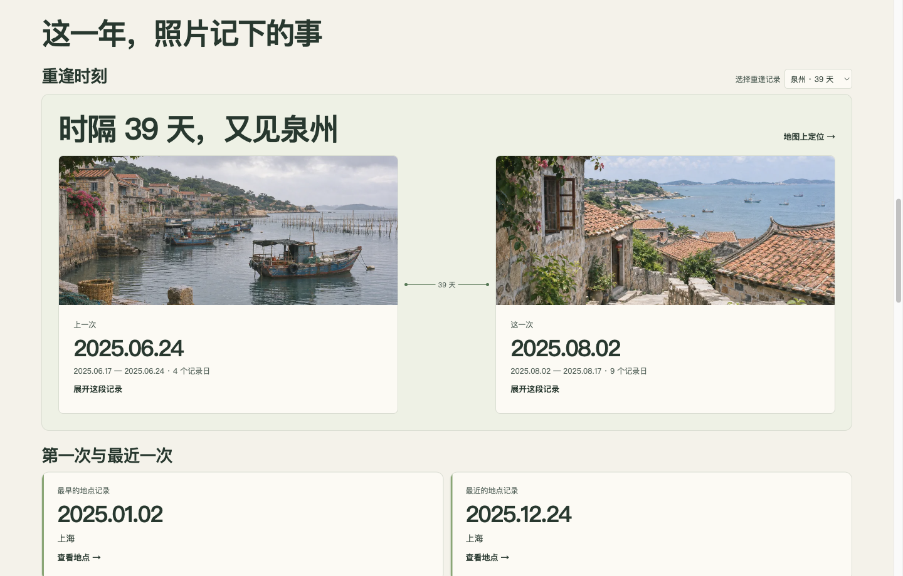
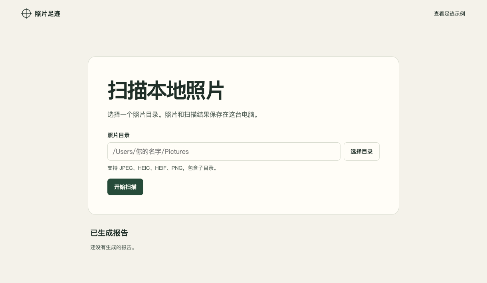

<p align="right"><a href="README.en.md">English</a></p>

<p align="center">
  
</p>

<p align="center">
  <a href="https://xiaosang.cc/photo-atlas/">▶ 在线体验</a>
  ·
  <a href="https://xiaosang.cc/photo-atlas/annual.html">照片报告</a>
  ·
  <a href="https://github.com/holynova/photo-atlas">GitHub 仓库</a>
</p>

照片足迹把散落在硬盘里的照片，变成一张去过哪里、何时重逢的城市地图：本地扫描照片的拍摄时间与 GPS，在地球仪上点亮去过的城市，按年份回顾初次到访、久别重逢与最长停留。原图、索引和缩略图全部留在本机，什么都不上传。

## 截图

<p align="center">
  
  
</p>

公开演示使用虚构记录和生成配图。

## 功能

- **城市足迹**：切换地球仪和平面地图，按年份或国家筛选；逐年点亮回放，看城市一座座亮起来。
- **补打卡与清单**：手动补录到访、做旅行清单；标记老家、工作地和常住地等城市角色。
- **照片报告**：回顾一年或多年里的初次到访、久别重逢、最长停留和城市变化；点开地图、日历或故事卡查看关联照片。
- **分享卡**：自选城市，导出无照片的足迹卡；照片报告的分享卡可选加入封面。
- **本地优先**：标注、手动打卡和旅行清单存在当前浏览器；重新扫描同一目录后可继续使用。

## 本地扫描

需要 Node.js 22 或更新版本：

```sh
git clone https://github.com/holynova/photo-atlas.git
cd photo-atlas
npm ci
npm run local
```

在浏览器里选目录或粘贴路径，点击**开始扫描**。完成后从「已生成报告」打开照片报告或城市足迹。也可直接运行 `npm run scan -- "/照片目录"`。

<p align="center">
  
</p>

- **只读四种格式**：JPEG、HEIC、HEIF 和 PNG；包含子目录，跳过隐藏项、符号链接和 Apple Photos 资源库包（Apple Photos 用户请先导出到普通文件夹）。
- **时间与城市**：优先读取 EXIF 原始拍摄时间；中国境内用 GPS 匹配市级行政区边界，境外用 15 公里内的城市参考点估算附近城市；无 GPS 的照片仍计入拍摄日期统计。
- **到访天数**：按有记录的自然日计算，同一天多座城市在总计里只计一次。
- **数据位置**：每次扫描保存索引和去除元数据的缩略图；macOS 默认存到 `~/Library/Application Support/Photo Atlas`，可用 `PHOTO_ATLAS_DATA_DIR` 自定义；服务仅监听本机回环地址。

## 技术

- 纯前端展示（`web/`，原生 JS + Canvas 地球仪）+ Node.js 本地扫描服务（`local/`）。
- 元数据读取用 exiftool-vendored，缩略图用 sharp；中国市级边界与境外城市参考点见 `assets/`。
- 底图与国别边界取自公共领域数据 Natural Earth 5.1.2；中国市级边界取自 chinese-global-compliant-geodata（来源天地图，见 `assets/china-cities.LICENSE`）；境外城市参考点取自 GeoNames（CC BY 4.0）。

```
web/                公开演示：足迹页、照片报告、分享卡
local/              本地扫描服务与扫描页（cli.mjs / scan.mjs / server.mjs）
assets/             地理数据（中国城市、世界城市中心、国家边界）与年度报告配图
scripts/build.mjs   构建公开演示包
docs/               本地扫描说明、足迹调研与 120 项报告指标
```

指标与调研见 `docs/footprint-research.md`，定位与统计细节见 `docs/local-scanning.md`。
