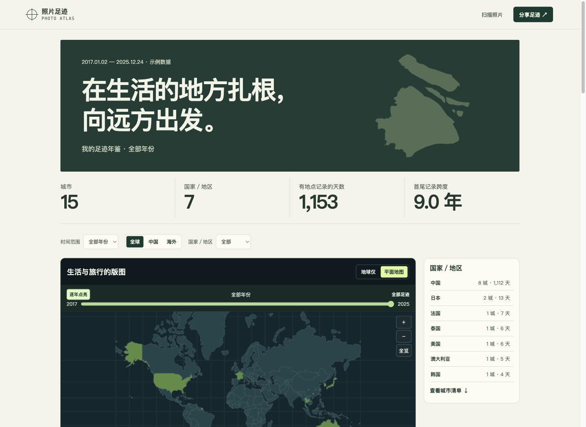

# 照片足迹 · Photo Atlas

把散落在硬盘里的照片，变成一张去过哪里、何时重逢的城市地图。

Scan a photo folder on your computer to map the cities you’ve visited and explore your photo history across years.

[在线体验 · Live demo](https://xiaosang.cc/photo-atlas/) · [照片报告 · Photo report](https://xiaosang.cc/photo-atlas/annual.html) · [本地扫描](#本地扫描) · [GitHub Repo](https://github.com/holynova/photo-atlas)

[](https://xiaosang.cc/photo-atlas/)

## 城市足迹与照片报告

- **城市足迹**　切换地球仪和地图，按年份或国家筛选。补打卡、做旅行清单，标记老家、工作地和常住地。可选城市，导出无照片的足迹卡。
- **照片报告**　回顾一年或多年里的初次到访、久别重逢、最长停留和城市变化。点开地图、日历或故事卡即可查看关联照片。

[](https://xiaosang.cc/photo-atlas/annual.html)

## 本地扫描

克隆仓库，在项目目录用 Node.js 22 或更新版本运行：

```sh
git clone https://github.com/holynova/photo-atlas.git
cd photo-atlas
npm ci
npm run local
```

在浏览器里选目录或粘贴路径，点击 **开始扫描**。完成后从「已生成报告」打开照片报告或城市足迹。也可直接运行 `npm run scan -- "/照片目录"`。


扫描只读 JPEG、HEIC、HEIF 和 PNG。拍摄时间与 GPS 来自照片元数据，原图、索引和缩略图留在本机。到访天数按有记录的日期计算。公开演示使用虚构记录和生成配图。

[定位、统计与发布命令](./docs/local-scanning.md) · [报告指标与调研](./docs/footprint-research.md)

<a href="https://xiaosang.cc/photo-atlas/"></a>
